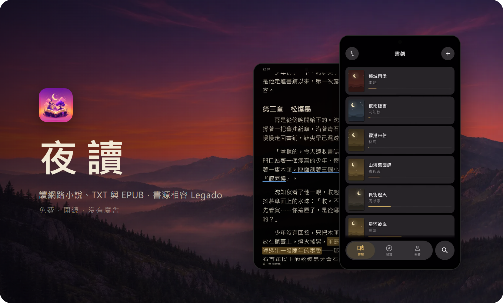
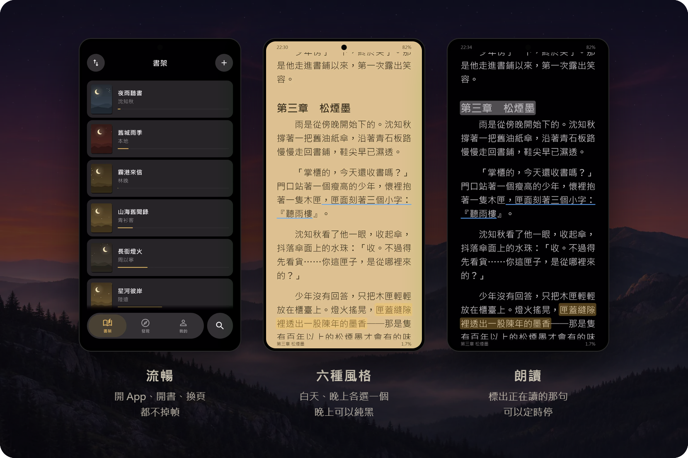
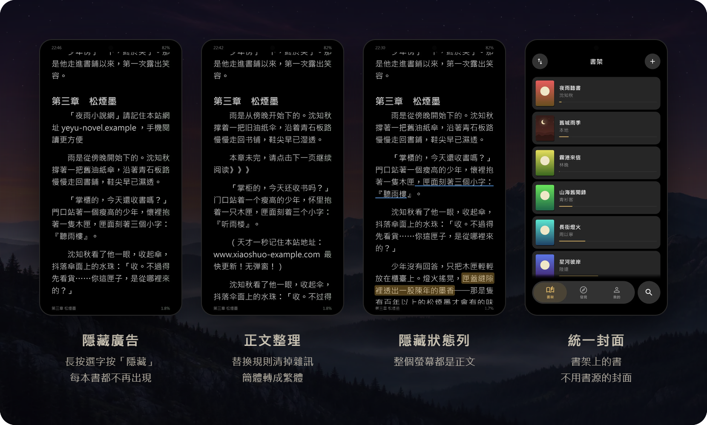
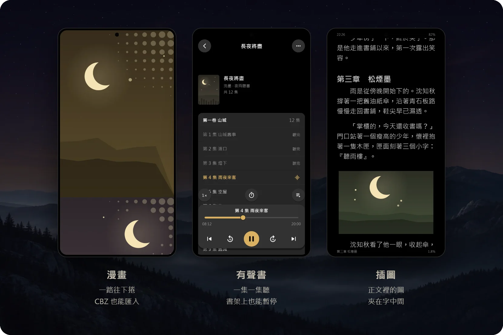
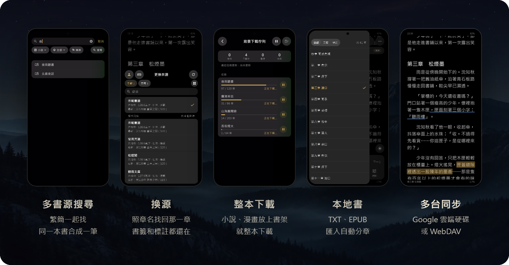
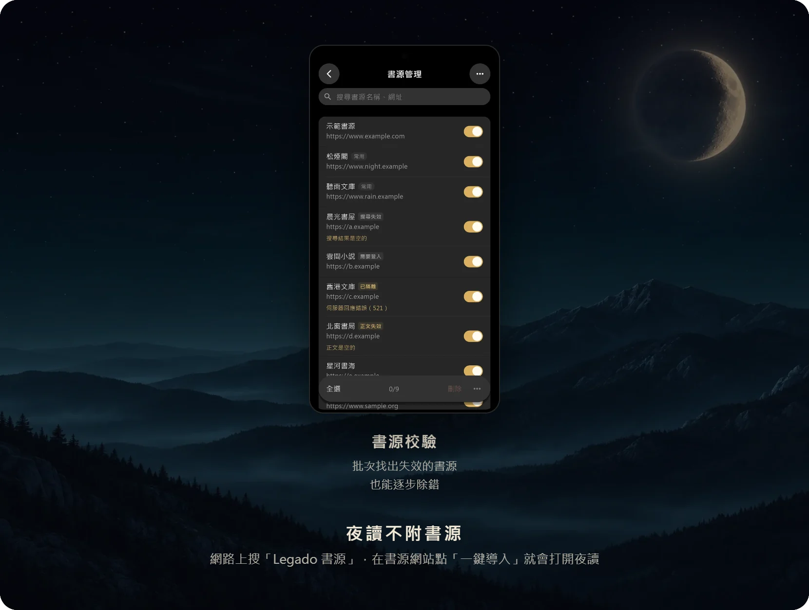

  

  <a href="https://github.com/bennytsai1234/Night-Reader/releases/latest"><b>下載 Android 版</b></a>
  &nbsp;·&nbsp;
  <a href="https://bennytsai1234.github.io/Night-Reader/">網站</a>
  &nbsp;·&nbsp;
  <a href="CHANGELOG.md">更新說明</a>

 

<b>iOS 怎麼裝</b>

 

同一個 [Release](https://github.com/bennytsai1234/Night-Reader/releases/latest) 附未簽章的 `.ipa`，用 AltStore 或 Sideloadly 以自己的 Apple ID 簽章安裝，免費帳號每 7 天重簽一次。iOS 版沒有 App 內更新、分享進 App 與用檔案開書，也沒在 iPhone 上試過。

<b>書源與本地書</b>

 

夜讀不附書源，剛安裝時書架與搜尋都是空的。在書源網站點「一鍵導入」，或在「我的 → 書源管理」用網址、檔案、剪貼簿匯入；書源格式相容 [Legado](https://github.com/gedoor/legado)，要登入的書源照 Legado 的方式登入。手邊的 TXT、EPUB 與漫畫（CBZ、ZIP、圖片資料夾）不用書源，在書架選「加入本地書籍」。

 

  
    <a href="https://github.com/bennytsai1234/Night-Reader/issues">回報問題</a>
    &nbsp;·&nbsp;
    開發文件：<a href="AGENTS.md">AGENTS</a>、<a href="DESIGN.md">DESIGN</a>、<a href="docs/adr/">ADR</a>
    &nbsp;·&nbsp;
    <a href="LICENSE">GPL-3.0</a>
  
   
  
    書源規則來自 <a href="https://github.com/gedoor/legado">Legado</a>，介面參考 <a href="https://github.com/TelegramMessenger/Telegram-iOS">Telegram iOS</a>，由 Claude 與 GPT 協助開發
  
   
  夜讀不提供任何小說內容或書源，取得與使用是否合法由使用者自行確認

