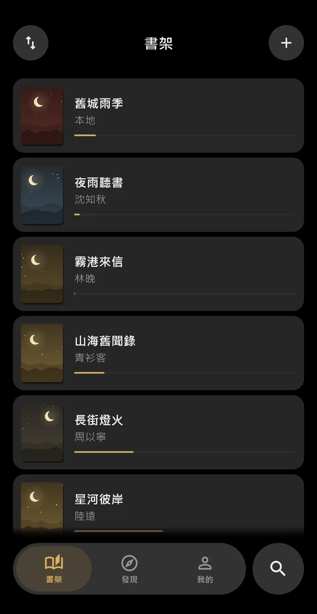
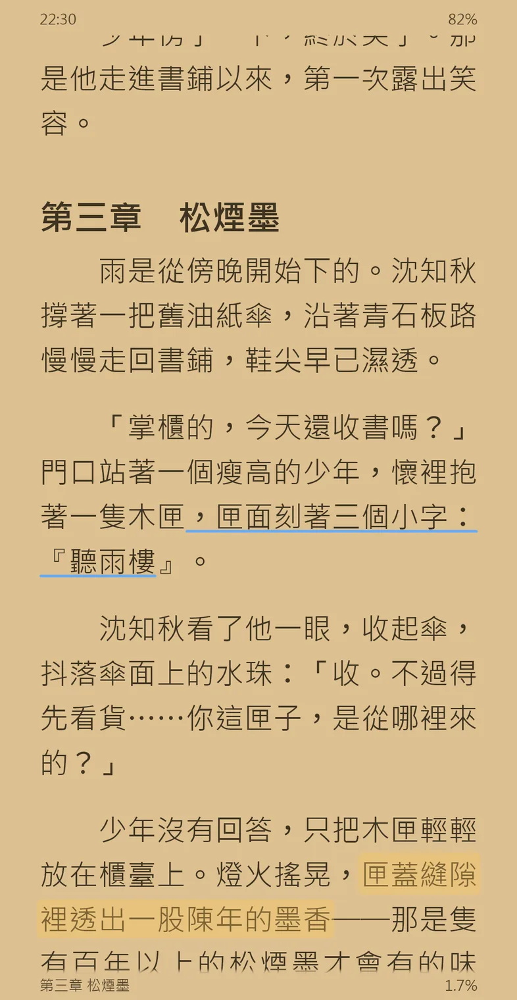
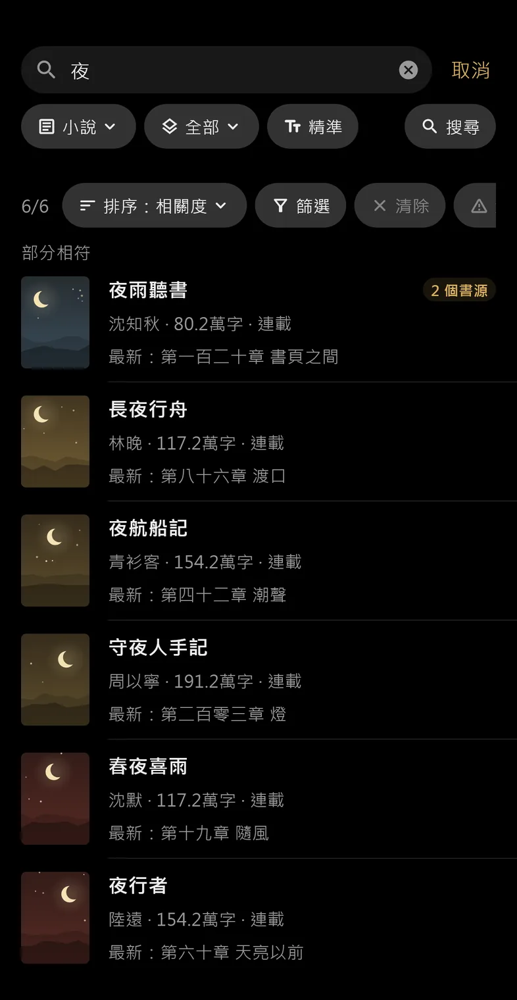
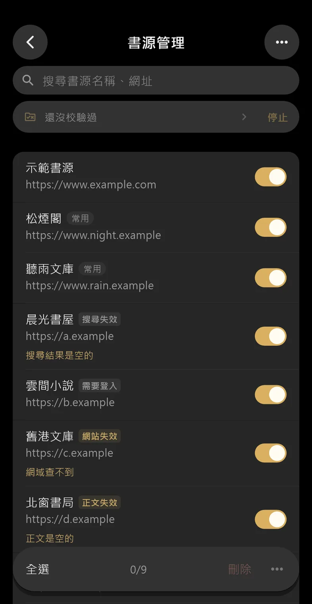

  

<h1 align="center">夜讀</h1>

<b>把長夜，留給長篇</b>

  讀網路小說、TXT 與 EPUB，書源相容 <a href="https://github.com/gedoor/legado">Legado</a> 
  免費・開源・沒有廣告

  <a href="https://github.com/bennytsai1234/Night-Reader/releases/latest"><b>下載 Android 版</b></a>
  ・<a href="https://bennytsai1234.github.io/Night-Reader/">網站</a>
  ・<a href="CHANGELOG.md">更新說明</a>

  
  
  
  

## 有什麼

**燈下**

- **每一幀都準時**　開 App、開書、換頁，畫面一路順到底
- **白天一種，晚上一種**　六種風格，白天晚上各挑一個，晚上可以純黑
- **閉上眼睛聽**　手機的語音朗讀，讀到哪句標到哪句，可以定時停

**留白**

- **廣告，選起來藏掉**　長按選字按「隱藏」，每本書都不再出現這段
- **正文自己整理**　替換規則清掉雜訊，簡體一律轉成繁體
- **只留下字**　藏起狀態列，整個螢幕都是正文
- **書架一個樣子**　統一封面，不用書源五花八門的圖

**枕邊**

- **一次搜遍書源**　繁簡一起找，同一本書合成一筆
- **換源不迷路**　換了書源還在同一章，書籤和標註跟著走
- **整本先下載好**　放上書架就整本下載，沒網路照樣讀
- **本地書也能讀**　TXT、EPUB 匯入就自動分章
- **換一台接著讀**　手機讀到一半，平板打開接著讀，經 Google 雲端硬碟或 WebDAV

**尋源**

- **書源壞了一眼看出**　批次校驗找出失效的，單一書源逐步除錯

每一項的畫面與短片在[網站](https://bennytsai1234.github.io/Night-Reader/)上。

## 開始使用

夜讀不附書源，剛安裝時書架與搜尋都是空的。網路上搜「Legado 書源」，在書源網站點「一鍵導入」就會打開夜讀；也可以在「我的 → 書源管理」用網址、檔案或剪貼簿匯入。要登入的書源照 Legado 的方式登入。

手邊的 TXT、EPUB 不用書源，在書架選「加入本地書籍」就能讀。

## 下載

- **Android**：到 [Releases](https://github.com/bennytsai1234/Night-Reader/releases/latest) 下載 APK，支援 Android 7.0 以上的 arm64 手機。想先用到新功能，在「我的 → 關於夜讀」打開「接收測試版更新」。
- **iOS**：同一個 Release 附未簽章的 `.ipa`，要自己用 AltStore 或 Sideloadly 以 Apple ID 簽章安裝（免費帳號每 7 天重簽一次）。iOS 版沒有 App 內更新、分享進 App 與用檔案開書，也沒在 iPhone 上試過。

## 回報問題

到 [Issues](https://github.com/bennytsai1234/Night-Reader/issues) 回報，附上 App 版本、手機型號與重現步驟；和書源有關的話，說明是搜尋、詳情、目錄還是正文出問題。

## 開發

以 Flutter 開發，APK 由 GitHub Actions 建置與發布。工具鏈與流程見 [AGENTS.md](AGENTS.md)，介面設計見 [DESIGN.md](DESIGN.md)，寫碼規範見 [CODING_STANDARDS.md](CODING_STANDARDS.md)，架構決定見 [docs/adr/](docs/adr/)。

## 致謝

- [Legado（閱讀）](https://github.com/gedoor/legado)：書源規則與許多功能設計來自這個開源閱讀器。
- [Telegram iOS](https://github.com/TelegramMessenger/Telegram-iOS)：介面結構與互動參考這個開源專案。
- Claude 與 GPT：協助本專案的開發。

## 授權

以 [GPL-3.0](LICENSE) 授權釋出。夜讀不提供任何小說內容或書源，書源與內容的取得和使用是否合法，由使用者自行確認。
